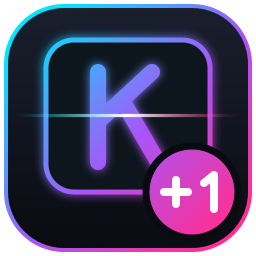

<div align="center">



# KeyMaster+1

**لوحة مفاتيح ميكانيكية ذكية — تحكم دقيق، تصحيح تلقائي، وإضاءة RGB بتأثير ليزر**
**A smart mechanical keyboard in your browser — precise control, auto-correction and RGB laser backlight**


</div>

---

## ✨ المميزات

- ⌨️ **لوحة مفاتيح تفاعلية**: اكتب بالكيبورد الحقيقي أو بالفأرة/اللمس، مع مفاتيح Shift وCaps وEnter وCtrl وغيرها.
- 🌐 **عربي ↔ English**: تخطيط عربي كامل (الهمزات، التشكيل، الرموز، الأرقام الهندية).
- 🧠 **تصحيح تلقائي**: تخطيط لوحة خاطئ (`hgsghl` ← السلام)، حروف مكررة، أخطاء شائعة، وأخطاء إملائية قريبة من القاموس.
- ↩️ **تحكم كامل بالتصحيح**: سجل بكل تصحيح مع «تراجع» و«تجاهل دائماً»، وقاموس شخصي محفوظ على جهازك.
- 🎯 **تحكم دقيق بالعتاد**: فلتر ارتعاش المفاتيح (Debounce) لحجب الضغطات المزدوجة، منع التكرار التلقائي، وخريطة حرارية للمفاتيح.
- 🎨 **إضاءة خلفية RGB**: 7 ألوان، شدة قابلة للضبط، وشعاع ليزر عند كل ضغطة.
- 🔊 **أصوات سويتشات ميكانيكية**: أزرق، بني، أحمر، أو صامت.
- 📊 **إحصائيات حية**: السرعة، الدقة، عدد التصحيحات، والضغطات المحجوبة.
- 🌗 **مظهر فاتح/داكن** وتصميم متجاوب.

## 🚀 التشغيل

لا يحتاج تثبيتاً ولا اتصالاً بالإنترنت:

```bash
git clone https://github.com/<username>/keymaster-plus-one.git
cd keymaster-plus-one
# افتح الملف مباشرة في المتصفح
open index.html        # macOS  |  xdg-open index.html (Linux)  |  start index.html (Windows)
```
## 🧩 كيف يعمل التصحيح؟

المحرك **محلي بالكامل** (لا يرسل نصك لأي خادم) ويعتمد على قواعد وقاموس مدمج:

1. كشف التخطيط الخاطئ عبر مطابقة الحروف مع تخطيط عربي/إنجليزي.
2. تقليص الحروف المكررة.
3. قاموس للأخطاء الشائعة.
4. مطابقة تقريبية بمسافة Damerau–Levenshtein (تبديل/حذف/إضافة حرف) بحسب مستوى الحساسية.

> ⚠️ القاموس المدمج صغير عمداً، لذا قد لا يُعرَف كل اسم أو مصطلح. أضف كلماتك إلى **القاموس الشخصي** لتبقى دون تغيير.

## 🗂️ هيكل المشروع

```
keymaster-plus-one/
├── index.html   # التطبيق كاملاً (HTML + CSS + JS في ملف واحد)
├── logo.svg     # شعار المشروع
├── README.md
└── LICENSE
```

## 🛣️ خارطة الطريق

- [ ] شريط اقتراحات الكلمات أثناء الكتابة
- [ ] وضع اختبار اللوحة لكشف المفاتيح التالفة
- [ ] فلتر ارتعاش مستقل لكل مفتاح
- [ ] تفعيل Ctrl/Alt (نسخ، لصق، تراجع) في لوحة الفأرة
- [ ] قاموس أكبر وملفات قواميس قابلة للتحميل

## 🤝 المساهمة

المساهمات مرحّب بها: افتح **Issue** لوصف المشكلة أو الفكرة، أو أرسل **Pull Request** بتغيير صغير ومركّز مع وصف واضح.

## 📄 الترخيص

مرخّص بموجب [MIT](LICENSE).

---

## English summary

**KeyMaster+1** is a single-file, dependency-free web app: an interactive mechanical keyboard with Arabic/English layouts, mouse and physical-keyboard input, a local rule-based auto-correction engine (wrong-layout detection, repeated letters, common typos, fuzzy dictionary matching), per-correction undo, a personal dictionary, switch debouncing, 7 RGB backlight colors and a laser effect on every keypress.

Open `index.html` in any modern browser, or publish the repo with GitHub Pages. Everything runs locally in your browser. Licensed under MIT.
# KeyMaster-1
